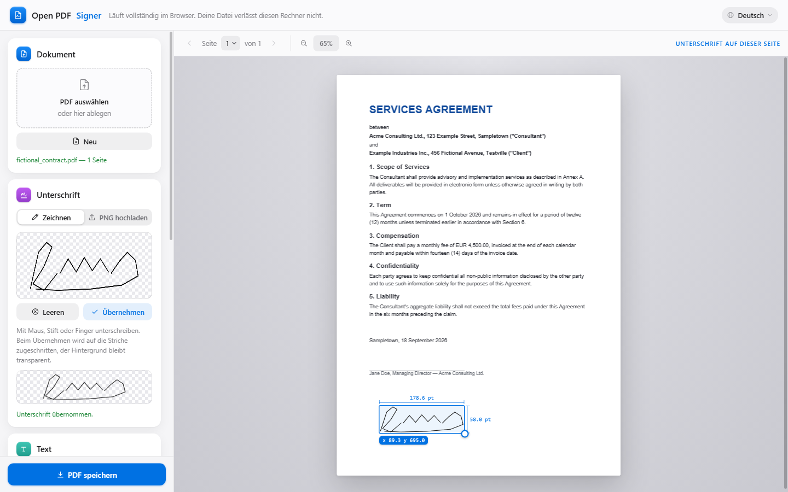

# Open PDF Signer

Tired of online PDF tools that make you register, cap you at three documents,
then push a subscription at you — all while your private paperwork sits on
someone else's server?

This is a single HTML file. Double-click it, sign your PDF, save it.
Free, unlimited, and fully local: **your document is never uploaded anywhere.**

## Features

- Load a PDF from the file picker or by dropping it onto the window, and page through it
- Create a signature by drawing with mouse, pen or finger — or upload (or drop) a transparent PNG
- Add text anywhere — in the **fonts already embedded in the document** where possible, plus the standard PDF fonts
- Optionally add a **real cryptographic signature** (CMS/PKCS#7) on save — the
  document becomes tamper-evident. Generate a free self-signed certificate
  locally or import your own `.p12`/`.pfx` (RSA or ECDSA on P-256, P-384 or
  P-521); the private key stays encrypted under your passphrase and is only
  decrypted — into a non-extractable browser key — when you unlock it.
  Counter-signing works: every earlier signature keeps verifying
- Zoom in and out smoothly with +/− buttons or the mouse wheel —
  it zooms around the pointer like a map, with a live preview that swaps to a
  sharp re-render the moment you stop scrolling — no jumps, and placements
  stay put. Ctrl/⌘ + wheel and trackpad pinch zoom as well; a two-finger
  swipe on a trackpad and Shift + wheel scroll instead
- Navigate the page by grabbing and dragging it with the mouse —
  signature and text boxes keep their own drags
- Drag to position it, use the corner handle to scale proportionally
- Live dimensions in PDF points while you drag, so you can see exactly where it will land
- Export as an **incremental update**: the original file stays in the output
  byte for byte and your marks are appended after it
- Keeps working where you left off: the session survives a page reload —
  document, signature, texts (with the document fonts they use), page and
  zoom are stored locally (IndexedDB) and restored on the next visit, marks
  on pages you have not looked at since included. **New** wipes the slate clean
- Available in 15 languages, picked up from your browser automatically

Existing text stays selectable and the page count never changes. Pages are
**not** flattened into images, which is what most "sign your PDF" tools do to
your document. Because the original bytes are kept and only new objects are
appended, everything the tool does not touch survives exactly as it was: the
metadata (Info dictionary and XMP), bookmarks, form fields, page labels, the
document language and tags. Existing digital signatures stay intact, too —
viewers will report that the document was changed after signing, which is
simply true, and the tool says so when you open a signed file.

## Usage

1. Download [`pdf-signer.html`](pdf-signer.html)
2. Open it in a browser (double-click works)
3. Load PDF → create signature → drag it into place → save

No installation, no build step, no server, no account.

## Privacy

Your PDF is read straight from disk by the browser and processed in memory.
There is no upload, no analytics, no tracking, no telemetry.

So your work survives a reload, the current session — the document itself,
signature, texts, positions — is kept in the browser's local IndexedDB on
your device. It never leaves the machine, and the **New** button deletes it.
A signing certificate lives in its own small store so **New** clears your
document but not your identity. The private key inside is sealed with
AES-256-GCM under a key derived from your passphrase (PBKDF2-SHA-256,
600,000 rounds; a new passphrase needs at least 8 characters). It is only
decrypted after you unlock it, and even then only into a non-extractable
browser key: page code can sign with it, but cannot read it out. Removing the
certificate asks first — the private key goes with it.

One honest caveat: pdf.js, pdf-lib, fontkit and node-forge are pulled from a
CDN the first time you open the page, so that initial load needs an internet
connection. The library versions are pinned and verified with Subresource
Integrity, so a tampered CDN response is refused rather than run — including
the pdf.js worker, which the page fetches and checks itself: if that check
fails, the tool stops instead of falling back to unverified code.
**After the page has loaded, no further network requests are made** — you
can watch this yourself in the Network tab of your browser's developer
tools while loading a PDF, signing it and exporting.

Want it fully offline? Download the five library files (pdf.js and its
worker, pdf-lib, fontkit, node-forge), put them next to the HTML file, point
the three `<script>` tags and the `PDFJS_URL`/`WORKER_URL` constants at your
local copies, and open the folder through a local web server (for example
`python -m http.server`). The server is needed because pdf.js is an ES module
the page fetches itself, and browsers refuse such fetches from `file://`.
The integrity hashes stay valid as long as the files are the same.

## Accuracy

Where the signature sits in the preview is where it lands in the exported PDF.
This is the part such tools usually get wrong, so it was verified end to end:
screen coordinates are converted into PDF points against the page's CropBox,
the flipped Y axis is accounted for, and `/Rotate` values of 0, 90, 180 and 270
are handled — including pages whose CropBox does not start at the origin.
Measured deviation between preview and export is below 0.02 pt (~0.007 mm).

Signature transparency is preserved: the PNG keeps its alpha channel and is
embedded with an `/SMask`, so you get your actual signature and not a white box
sitting on top of the text.

## Document fonts

The text tool reads the fonts a page actually typesets straight out of the
PDF and offers them in the font picker. What you see in the preview is the
real embedded font, and the same font file is embedded into the output — so
added text blends into the document instead of looking stamped on.

One caveat is inherent to how PDF works: most embedded fonts are **subsets**
that contain only the glyphs the document itself uses. If your new text needs
a character the subset lacks (say a Cyrillic letter in an all-Latin file), the
tool tells you which characters are missing before writing anything, rather
than silently producing blank spots — pick a standard font in that case. For
the same reason a document font is only preselected when it covers the whole
Latin alphabet and the digits; otherwise the picker starts on Helvetica and
the document's fonts stay one click away.

## Legal scope

The tool offers two ways to sign:

- **Image signature** — a *simple electronic signature*: an image of your
  handwritten signature placed into the PDF. Under eIDAS (EU) and
  ESIGN/UETA (US) that is legally binding for most everyday contracts,
  since consent matters more than the technology used.
- **Digital signature** — a real cryptographic CMS/PKCS#7 signature embedded
  in the document, which makes the file tamper-evident: changing a signed
  byte breaks the signature, and changes appended afterwards (a
  counter-signature, say) are reported by every validator as made after
  signing. With an imported CA-issued certificate (`.p12`/`.pfx`) it also
  chains to that CA's trust.

Honest limits: a self-signed certificate proves integrity and key control,
but viewers show "identity unknown" rather than a green checkmark — a
certificate authority has to vouch for your identity for that. And neither
mode is a *qualified* electronic signature (QES), which requires a qualified
trust service provider — where the law demands QES or wet ink (notarized
documents, certain employment contracts), a dedicated signing service is
the right tool.

## Languages

English, 中文, हिन्दी, Español, العربية, Français, Português, Русский, 日本語,
Deutsch, Indonesia, Türkçe, 한국어, Italiano and Tiếng Việt.

The interface follows your browser's language and falls back to English.
You can switch it any time in the top right, and the choice is remembered.
Arabic switches the layout to right-to-left — the document preview itself is
never mirrored.

Adding a language means adding one block to the `T` object in the file.
Pull requests welcome.

## Notes

- Tested in Chrome. Any modern browser with Pointer Events support should work.
  Digital signatures need a secure page (opened directly from disk, or over
  https), because they rely on the browser's built-in cryptography.
- Encrypted PDFs are refused on open — both those that need a password to
  open and those that only restrict editing (common for bank statements).
  The tool cannot decrypt them, and anything it added would be unreadable.
- One signature image per save, placed on the page you put it on.
- Text fields are unlimited; each lives on the page where it was added.

## Built with

- [pdf.js](https://mozilla.github.io/pdf.js/) — renders the pages, exposes the embedded fonts
- [pdf-lib](https://pdf-lib.js.org/) — writes the output PDF and the signature field
- [fontkit](https://github.com/foliojs/fontkit) — glyph coverage checks and font embedding
- [node-forge](https://github.com/digitalbazaar/forge) — builds the CMS/PKCS#7 signature and handles certificates

## License

MIT — see [LICENSE](LICENSE).
